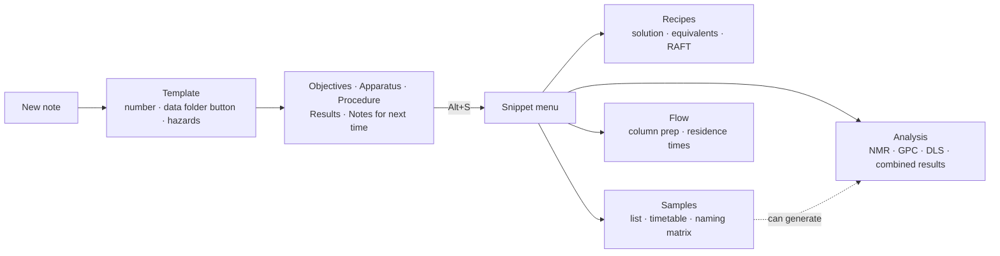
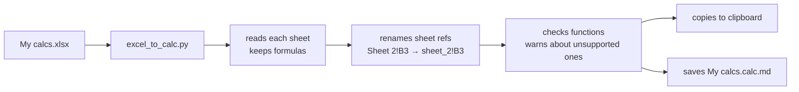

---
cssclasses:
  - academia
  - academia-rounded
  - scrolling_mermaid
---
# 🧰 Lab notebook kit: tutorial

> [!summary] The kit in one minute
> 1. **New note** in your Notes folder → name it → it's numbered and gets a hazard table, a data-folder button and five sections.
> 2. While writing, press **Alt+S** → pick a snippet → fill **one form** → a ready-made table appears.
> 3. Tables in ```` ```calc ```` blocks **calculate live**: click a cell to type, they update everything that depends on them.



---

## 1. Starting an experiment

1. Run **New lab entry** from the command palette (or create a new note in your Lab notes folder).
2. Type the title in the box that pops up (e.g. `Batch esterification of PABTC`).
3. You get `0016 - Batch esterification of PABTC` with:
   - **← Lab book**: back to the Lab book board
   - 📁 **Open data folder**: opens `<your data folder>/0016 - …` (made when you press the button; set the data folder in Settings → Lab Kit)
   - ⚠️ **Hazards**: fills in once you add chemicals to the **Chemicals** property
   - **Objectives · Apparatus · Procedure · Results / Analysis · Notes for next time**

> [!tip] Repeating an experiment
> **Clone experiment** (command palette) copies the open lab note, or one you pick, into a new numbered lab note: properties, objectives, apparatus, procedure, rig and tables are kept with the sample codes renumbered; Status goes back to Planned, dates, Outcome and the free text under Results / Analysis and Notes for next time are cleared. The title box starts with the old title, the new note links back to the old one in `Cloned from`, and the old note is not changed. (Not seen in Obsidian yet.)

> [!tip] Add chemicals early
> Put them in **Chemicals** as links (`[[DCM]]`): the hazard table is built from this property. The snippet forms start empty; to pick chemicals quickly in them, set **Chemical folder** (section 6) and they suggest your notes as you type.

---

## 2. Snippets (Alt+S)

Put your cursor where you want the table, press **Alt+S**, type a few letters to filter, press Enter. Each snippet opens **one form**; press **Enter** to insert or **Esc** to cancel. Forms start empty (grey placeholders show what to type), and submitting an untouched form inserts nothing.

> [!note] One-time setup for Alt+S
> Snippets need [Templater](https://github.com/SilentVoid13/Templater). Install the kit files first (see section 7), then:
> 1. Settings → Lab Kit → Setup → **Check setup…** → press **Fix** on the Templater rows. That adds `Insert snippet.md` to Templater's **Template hotkeys** and sets its **User script functions** folder when it has none (a folder you set yourself is never changed). Doing it by hand works too: Settings → Lab Kit → **Manage files…** shows where each kit file is.
> 2. Obsidian → **Hotkeys** → search for *Insert snippet* (Templater lists it as "Templater: Insert …Insert snippet") → set **Alt+S**. Or let Lab Kit do it: **Check hotkeys…** shows which of the recommended keys are set, and its **Set the suggested keys…** sets the ones that are free after you confirm (a key you have is never changed).
> 3. If the forms ask one question at a time, Templater's **User script functions** folder is not the folder that holds `labSnippets.js` (Templater also reads subfolders, so a folder above it works too). See Troubleshooting.
>
> Set **Settings → Lab Kit → Initials** too: the sample codes use them (`ABC0016-A`). Until then they use `XX` and a notice says so.

| Snippet | Use it for | Gives you |
|---|---|---|
| **Solution prep** | Making up a stock solution | Targets table (final volume, optional total concentration) + one row per solute and solvent: MW (from the chemical note) · target (M, mg/mL or g, or a total concentration split by a ratio) · added in g or mL (mL uses the row's Density) · mmol · concentration reached |
| **Recipe by equivalents** | Planning amounts from eq. | Eq. *relative to* any reagent, the first reagent's amount in mmol, g or M (× volume), solvent "rest" row, total mass, wt% |
| **RAFT recipe generator** | RAFT / PISA | Monomer mass, DP, CTA:I, solids → every mass, solvent (and an optional co-solvent as % of its mass), Mn (several monomers: the mol fractions always add up) |
| **Variant naming matrix** | A grid of conditions | `ABC0016-A`, `-B`… · **Copy** gives one column for Excel |
| **Sample list** | Samples without times | Typed or generated codes · add the analysis tables afterwards (NMR / GPC / DLS / your own methods, Combined results) |
| **Sampling timetable** | Kinetics | Codes per time point, **target clock times** from a start time · add the analysis tables afterwards |
| **NMR samples** | NMR submissions | Sample · solvent · method · conversion · dataset · checklist · tags the note `NMR` |
| **GPC samples** | GPC | Sample · eluent · Mn · Mw · Đ (calculated) · tags `GPC` |
| **DLS samples** | DLS | Sample · solvent · temperature · Dh · PDI · tags `DLS` |
| **Combined results** | Pulling it together | One row per sample with conversion, Mn, Mw, Đ, Dh, PDI, and the results of your own methods (section 6.1) |
| **Flow column prep** | Packing a column | Weighings (and the packing material) → bead mass → reactor volume. Optional solvent: its note's Density fills the density row (a density you type wins) |
| **Residence times** | Flow rates | Flow for each residence time (+ optional check of flow rates) |
| **Rig** | A flow experiment | Pick a rig note: a link and a fixed copy of its diagram at the cursor with the rig note's `Summary` table (if it has one) right under it, a `Rig` property on the note, and the tubing, control and parts tables as they are today at the bottom under `Flow platform setup` (added when the note has none; filled in per run there) |
| **Blank calc table** | Anything else | Your own columns |

> [!example] A typical analysis workflow
> 1. **Sampling timetable** → times `0, 30, 60, 120`, letters `A, B`, start `10:30`. Then **NMR samples** and **Combined results** (they take the codes from the timetable).
> 2. On the day, type the real times in **Taken at**.
> 3. Type conversions into the **NMR** table: the **Results** table fills itself in.
> 4. **Copy** on the Results table → paste into Excel or Origin.

> [!tip] Several sample tables
> The NMR / GPC / DLS / method / Combined results snippets fill their Sample codes box with the codes of every table in the note that holds sample codes. With more than one such table a **Codes from** choice appears: "All of them" (the default) or one table by its title; text you type in the box is used as it is. A table says it holds codes with the block option `codes:` (section 3.3); the Sample list, Sampling timetable and Variant naming matrix have it already. The Results table links every `nmr`, `nmr2`… table.

---

## 3. Calc tables

### 3.1 Reading a table
| Colour | Meaning |
|---|---|
| plain | a value you typed |
| 🟦 blue | calculated by a formula |
| 🟧 amber text, "needs MW · DMAm" | can't be calculated yet: it tells you which input is missing |
| 🟧 amber outline on an empty cell | this is an input something is waiting for |
| 🟥 red | a real problem (hover it for the reason) |

### 3.2 Editing
| To… | Do this |
|---|---|
| change a value **or a formula** | **click the cell**, type, **Enter** or **Tab** to save, **Esc** to throw away what you typed |
| add a row | **+ Row** (adds above *Total* / *(rest)* rows, copies the formulas down) |
| insert or delete a specific row | **right-click** the row |
| see cell addresses | **A1** |
| send to Excel | **Copy** |
| change options or lots of text | hover → Obsidian's `</>` button (top right), or arrow into the block |

> [!tip] See what a formula points at
> While you type a formula, each reference gets its own colour: the cell it points at (this table or another table in the note) is outlined and shaded in that colour, and the reference in the box is coloured to match. The column letters and row numbers show on the table while you edit. It all goes when you press Enter, Tab or Esc, or click away. It works for `B2`, `$B$2`, `B2:C5` and `sol1!B2`. The same colours show in the table's text (Source mode, or Live Preview with the cursor in the block), without the letters and numbers.

> [!note] Rows and references
> Like Excel: when you add a row, `SUM(B2:B4)` becomes `SUM(B2:B5)`, and other tables pointing into this one (`sol1!B5`, `XLOOKUP(…, nmr!B$2:B$4, …)`) are updated too. Deleting a row that something points at gives `#REF!`.

> [!warning] Give every table its own name
> If two `calc` tables in a note have the same `name:`, both show a red "⚠ name used twice". Any reference to that name shows `#REF!` until you rename one.

### 3.3 Writing formulas
Formulas start with an equals sign (=) and use **Excel syntax**. Row 1 is the header row, so the first data row is row 2. The examples below are shown without the leading = (type it in the cell).

- Same table: `C2*D2/1000`
- Another table in the note: give it a `name:` and use `sol1!D2` or `SUM(sol1!D2:D4)`
- Molar mass from a chemical note: `MW(A2)` (reads the property named in **Molecular weight property**, else `MW`, `Mr`, `Molecular weight`, `Molar mass` or `M_w`; the cell can hold `[[DCM]]` or `DCM`)
- Any property: `PROP("PABTC", "Density")`
- Typing `[[` in a cell suggests your chemical notes once **Chemical folder** is set (section 6)
- Lookups: `XLOOKUP(A2, nmr!B$2:B$9, nmr!E$2:E$9, "")`
- Clock time: `CLOCK("10:30", 90)` → `12:00`

Residence time, as used in the flow snippets:
$$\tau = \frac{V_{\text{reactor}}}{Q} \qquad Q = \frac{V_{\text{reactor}}}{\tau}$$

> [!info]- All functions
> `SUM AVERAGE MIN MAX COUNT COUNTA PRODUCT SUMPRODUCT ROUND ROUNDUP ROUNDDOWN INT ABS SQRT POWER EXP LN LOG LOG10 MOD PI IF IFERROR AND OR NOT CONCAT MATCH INDEX XLOOKUP CLOCK MW PROP`

> [!info]- Block options (lines above the table)
> | Option | Example | Does |
> |---|---|---|
> | `name:` | `name: sol1` | lets other tables use this one |
> | `title:` | `title: Solution 1` | caption |
> | `icon:` | `icon: flask-round` | caption icon, any name from lucide.dev |
> | `decimals:` | `decimals: 3` | fixed decimals |
> | `sig:` | `sig: 4` | significant figures for small numbers |
> | `grid:` | `grid: true` | start with A1 labels shown |
> | `copy:` | `copy: list` / `copy: column A` | what **Copy** puts on the clipboard |
> | `codes:` | `codes: column A` / `codes: cells` | the table holds sample codes: NMR, GPC, DLS, method and Combined results snippets offer them under **Codes from** (all of them by default). Full syntax: `docs/snippet-syntax.md` |

---

## 4. Hazards
The table lists every chemical in **Chemicals**, worst first, with each H-code coloured by severity. It needs each chemical note to have an `H_Phrase` list property. It shows one row per chemical with a chip per H-code (hover for the full phrase); Settings → Lab Kit → Hazards → Layout switches to the two-column table. It only redraws when this note's Chemicals or a linked chemical note changes. The header is a ```` ```lab-header ```` block; **Insert lab header block** in the command palette adds one.

All the options are in Settings → Lab Kit → Hazards. To change one for a single note, put it inside the block, one per line:

````
```lab-header
layout: table
collapsed: false
showLegend: false
```
````

| Option | Values | Default |
|---|---|---|
| `layout` | `chips` or `table` | `chips` |
| `chemicalsProperty` · `classProperty` | property names | `Chemicals` · `Exp. Class` |
| `hideForClasses` | comma-separated classes | `in-silico, setup` |
| `collapsed` | hazards behind a one-line summary | `true` |
| `startOpen` | summary starts expanded | `true` |
| `showSummaryCounts` | "Severe 1 · High 2" in the summary | `true` |
| `showLegend` · `legendDetails` | colour key, with categories | `true` · `false` |
| `sortByWorstHazard` | off = A to Z | `true` |
| `highlightWholePhrase` | colour the whole phrase, not just the code | `false` |
| `showCategoryLabels` | "Cat 2" after each code | `false` |
| `shadeChemicalCell` · `centreChemicalCell` | shade / centre the name | `true` · `true` |
| `showMissing` | list chemicals with no note or no `H_Phrase` | `true` |
| `dataFolder` · `hazards` · `back` | `false` leaves out the button / the hazards / the Lab book link | `true` |

---

## 5. Excel → calc tables (the Python script)

> [!question] What does it do?
> It reads an Excel file, takes every cell (values **and formulas**) and writes them out as ```` ```calc ```` blocks. Each sheet becomes one block named after the sheet, so `Recipe!B5` in Excel becomes `recipe!B5` and still works in Obsidian.



**One-time setup**
1. Install Python from python.org (tick **Add python.exe to PATH**).
2. Open **Terminal** (or Command Prompt) and run: `pip install openpyxl`

**Each time**
1. In File Explorer, go to the folder with your Excel file.
2. Click the address bar, type `cmd`, press Enter. A terminal opens in that folder.
3. Run (change the path to where your vault is):
   ```
   py "C:\path\to\vault\Extras\scripts\excel_to_calc.py" "My calcs.xlsx"
   ```
4. Paste into your note (**Ctrl+V**). The result is already on the clipboard.

| Option | Example | Does |
|---|---|---|
| `--sheet` | `--sheet Recipe` | only this sheet (repeat for more) |
| `--range` | `--range A1:G8` | only these cells (one sheet) |
| `--name` | `--name recipe` | the block's name (one sheet) |

> [!warning]
> - Google Sheets: **File → Download → Microsoft Excel (.xlsx)** first.
> - Excel shows `15%` but stores `0.15`. Check percentage cells.
> - Functions Lab Kit doesn't know are listed as warnings; those cells show `#NAME?` until you rewrite them.

---

## 6. Customising

| Change | Where |
|---|---|
| Your initials in sample codes | Settings → Lab Kit → Initials (empty until you set it; snippets use `XX` and say so) |
| Your chemical notes | Settings → Lab Kit → Chemical folder (new vaults: `05 Chemicals/Chemicals`; empty = no suggestions, and no Chemical database template or base). New chemical notes: the command **New chemical** (asks the name, then the class: pick one your notes already use, type a new one, or no class) or a note made by hand in the folder, both from the kit's **Chemical database template**; the **Chemical database** base in the folder above lists them. Typing `[[` in a calc cell, and the reagent / solvent fields of the Alt+S forms, then suggest the notes in it by file name or by their **Names** property (a list or one value). Picking a name found through **Names** inserts `[[Note\|name]]`. In a form, **Enter** picks the highlighted suggestion; Enter again inserts. Give a chemical a `Chemical class` (a list: `solvent`, `monomer`, `initiator`, `CTA` or any class of your own): the Solvent, Monomer, CTA and Initiator fields suggest those first; **Only suggest chemicals of the asked class** hides the rest. |
| Where new experiment notes go | Settings → Lab Kit → Lab notes folder (used by **New lab entry**; the kit's **Lab book base**, a board of experiments by Status, goes in the folder above it) |
| Which property holds the molecular weight | Settings → Lab Kit → Molecular weight property (empty = MW, Mr, Molecular weight and similar are tried) |
| Your own analysis methods and machines | Settings → Lab Kit → Methods folder (empty = only the built-in NMR, GPC and DLS; a folder that does not exist yet is created when you leave the box). See section 6.1 |
| Your flow rigs | Settings → Lab Kit → Rigs folder (empty: `03 Lab Book/Rigs`, shown greyed; a folder that does not exist yet is created when you leave the box or run New rig). Then Review update… installs the **Rig template**, and the command **New rig** asks a name and makes the rig note: fill in the parts tables (`ID`, `Feeds`) and the `rig` block at the top draws the diagram |
| Data folder (e.g. on Google Drive) | Settings → Lab Kit → Lab notebook → Data folder root (one for Windows, one for macOS / Linux; empty until you set it) |
| A snippet's menu icon | Settings → Lab Kit → Lab notebook → Snippet icons (press **Choose…** and pick an icon, or type a Lucide name; empty keeps the built-in one) |
| A snippet's built-in icon or text | first two lines of its file in the `Snippets` folder next to `Insert snippet.md` (`// icon:` and `// desc:`); a token template (variant matrix, sample list, timetable, column, residence times, blank table, rig) has `icon:` and `desc:` in its header |
| What a snippet builds | the solution, recipe, RAFT, NMR, GPC, DLS, method and Combined results snippets: `labSnippets.js` in your Templater user scripts folder (one section per snippet). The other seven (the six above and Rig) are plain notes in the `Snippets` folder: a header with the questions, then the text with `{{tokens}}` (the Lab Kit plugin fills them) |
| A new snippet | Settings → Lab Kit → **Manage files…** → **Make my own copy** on a snippet row (asks a name, never overwrites, and updates never touch the copy), or copy a file in the `Snippets` folder by hand and give it a new number and name. Token syntax: [snippet-syntax.md](snippet-syntax.md) |
| Leave a snippet out of the Alt+S menu | Settings → Lab Kit → **Manage files…** → switch its **Use** toggle off (see section 7) |

> [!tip] Icons
> Browse [lucide.dev](https://lucide.dev/icons) and use the icon's name, e.g. `flask-round`, `test-tube`, `beaker`, `atom`, `droplets`. A comma-separated list tries each name in turn.

### 6.1 Analysis methods and machines
One note per method in your **Methods folder** (Settings → Lab Kit), for example `Mass spec.md`:

```yaml
---
Columns:
  - Sample
  - "Ionisation: ESI"
  - Expected m/z
  - Found m/z
  - 'Error (ppm): =IFERROR(({Found m/z}-{Expected m/z})/{Expected m/z}*1000000, "")'
  - Notes
Results:
  - Found m/z
  - Error (ppm)
Machines:
  - "[[Machine A]]"
  - "[[Machine B]]"
Default machine: "[[Machine A]]"
---
```

and one note per machine (`Machine B.md`), whose properties fill the columns of the same name:

```yaml
---
Ionisation: APCI
---
```

| Property of the method note | Meaning |
|---|---|
| **Columns** | One item per column. `Name` is an empty column, `Name: text` has that default, `Name: =formula` is a formula (`{Other column}` = that column in the same row), `Name: {n}` numbers the rows. The first column holds the sample code (or the one named in **Sample column**) |
| **Results** | Columns that **Combined results** pulls in, by sample code |
| **Machines**, **Default machine** | Links to machine notes. The table gets a **Machine** column and the form a dropdown; a field left at the default machine's value follows the machine you pick |
| **Title**, **Icon**, **Tag**, **Checklist** | Heading and table title (default *Name samples*), Lucide icon, tag added to the note, checklist lines (default Submitted / Results processed / Results saved) |
| **Dataset folder** | `true` adds a *Dataset:* line and form field, like NMR |

> [!note] Good to know
> - Property names ignore case and spacing. Edit the properties in Obsidian's Properties view, or quote items that contain `:`, `#` or `{`.
> - Every method note appears in the Alt+S menu on its own (as *Name samples*, with its **Icon**), after the numbered snippets. A new or edited note shows up the next time you open the menu.
> - A note without **Columns** in the folder is ignored (a README is fine).
> - NMR, GPC and DLS are always there; a note called `GPC` replaces the built-in one entirely.
> - The tables are named after the method (`mass_spec`, `mass_spec2`…). Changing a method note later does not change tables already in a note.

---

## 7. Updating the kit

The kit files (templates, scripts, CSS snippet) are built into the plugin, so this works on desktop and mobile. It needs Obsidian 1.14 or newer. **Settings → Lab Kit → Updates** (the update buttons; Check setup and the kit's folders are in the next group, **Setup**). The lab kit and the planning kit (section 8) each have their own row of these buttons:

| Button | Does |
|---|---|
| **Review update…** | a preview of every file: what needs action first (conflict, merges cleanly, missing, update, new), then changed by you. Every file that would change has a tick box (**Tick all / Untick all**), so you can leave single files out. Nothing is written until you press **Apply** |
| **Update all safe files** | adds new files and updates the ones you never edited (the first install asks first). It never merges. With the planning kit on, the row is called **Kit files** and the three buttons cover both kits: one window with a section for each kit (updates first), one confirmation, one report |
| **Check setup…** (Fix on the Templater rows) | sets Templater's user scripts folder only when it has none (one you set is never changed; if the kit's scripts are outside it, it offers to install copies into `<your folder>/lab-kit`), fills in its template folder only when that is empty (one you set is never changed), and adds *Insert snippet* to its Template hotkeys. It lists these changes first and makes only the ones you leave switched on. Press Fix once after installing the kit, then set **Alt+S** in Obsidian → Hotkeys |
| **Manage files…** | every kit file with a status (files that need action first), and buttons to update, restore the kit's original, detach / re-attach or open it one file at a time. Each snippet row has **Make my own copy**. It also has a switch for the kit's CSS snippet |
| **Clear old backups…** (a row whose name is the action) | lists the dated backup folders and moves the ones older than 30 days, older than 7 days, or all of them, to the trash |

- **Backups:** every file an update replaces is copied to the Backup folder first. The Templates, Scripts and Backup folders are settings (empty = detected).
- **A file you changed** is never overwritten. If your edits and the kit's touch different lines, it is listed under "merges cleanly" and you can tick it to merge. In the Lab Book template the properties are merged one by one, so a property you added stays.
- **Conflict:** if you and the kit changed the same lines, the file shows **Conflict** and is left alone. Press **Resolve…**, choose for each change whether to keep yours, take the kit's, keep both or edit it, check the preview and press **Apply**. **Keep all mine** and **Take kit version** settle the whole file at once.
- **Use toggle:** each snippet, and the Excel converter `excel_to_calc.py`, has a switch in **Manage files…**, with a one-line description. Off = not installed and not in the Alt+S menu. Switching off a snippet you already have asks first, copies it to the Backup folder and moves it to your trash. Switching it on installs it again. **Update all safe files** never installs a switched-off snippet.
- **Kept files:** a file you are meant to edit (the Lab book base, the planning kit's homepage, boards and hub notes) is marked as kept: the kit never updates it. The planning kit's guide notes (Vault spec, How my vault works, Hotkeys, Setting up a computer, Set up ZotLit) are not kept: an unedited one is updated like a template. When the kit has a newer text for one, a notice at start-up says how many, the settings tab lists them, and the row in **Manage files…** shows "Newer kit version available" with **Compare…** (the merge window), **Use kit version…** (asks first, backs yours up) and **Keep mine** (leaves yours; the newer version stays on offer).
- **Renamed files:** when the kit renames a file (Weekly meeting.md became Meeting.md), Review update… moves your copy to the new name; a file you kept, or one with unresolved edits, stays where it is.
- **Retired:** if a later kit stops shipping a file you installed, it is listed as **Retired**. It stays in your vault; **Forget** stops listing it.
- **First install:** before anything is written, a list shows the files to create, files left alone because they already exist, the folders to create, and the settings changes, each with a switch (on): **Turn on the CSS snippet**, **Set Templater's user scripts folder** (only when Templater has none; a folder you already set is never changed) and **Add Insert snippet to Templater's Template hotkeys**. Cancel writes nothing.

The plugin itself (calc tables, header, windows) updates through Obsidian: **Settings → Community plugins → Check for updates**. A new plugin version brings the new kit with it, but your templates and scripts only change when you press **Apply** here. When Obsidian starts after such an update, a notice says **Lab kit vX is ready → Review**. Switch it off with **Settings → Lab Kit → Tell me when a kit update is ready**.

After an update, a **What's new** popup opens once. Open it again from **Settings → Lab Kit → What's new** or the command **Show what's new**.

> [!tip] Moving kit files
> Move or rename kit files **inside Obsidian** and the kit follows them. If you move them in File Explorer instead, the kit can't follow: they show as **Missing** in **Manage files…** until you move them back.

---

## 8. Planning kit

> [!note] Off until you switch it on
> The planning kit is new in 1.0.0: most of it is tested in code and not yet used by many people in Obsidian. Report what breaks on GitHub.

The planning kit turns the vault around the lab book into a planner: a homepage, a to-do board, projects, meetings, knowledge notes and an inbox. The day-to-day routine (what to press in the morning, the Friday review) is in the note it installs, **How my vault works** (the **How it works** button on the homepage); this section says what there is and how to set it up.

### 8.1 Switching it on
1. Settings → Lab Kit → Updates → **Planning kit** → on. Switching it off later removes nothing.
2. **Kit files** (the row that covers both kits once the planning kit is on) → **Review update…** → **Apply**. The window has a section for each kit, the one with something waiting first and open, and a list shows every file, folder and setting first. The planning commands start once the files are installed.
3. **Check setup…** lists what is missing, with a **Fix** where Lab Kit can make the change (the window stays open while you work through it; **Check again** redraws it): kit files that are missing or have an update waiting, Obsidian's own Bases and Daily notes plugins, the Daily notes folder and date format, Dataview's inline queries, the types of `due`, `deadline` and `priority`, the plugins (needed: Dataview, Meta Bind, Force note view mode, Omnisearch, Notebook Navigator; optional: ZotLit, Outliner, Editing Toolbar, CSS Editor, Advanced Canvas; Lab Kit never installs a plugin), the Meta Bind buttons, Templater's folder templates (daily notes and to-dos), the homepage in Notebook Navigator, the meeting series, and the CSS snippets. With ZotLit on there are two more rows, **ZotLit frontmatter fields** and **ZotLit folders**: Fix adds only the fields that are missing and sets a folder only when it is empty, never changes a field you have, then turns ZotLit off and on so it reads them. Restart Obsidian after the Meta Bind Fix: it loads its buttons at start-up.
4. The folders are settings (Settings → Lab Kit → Planning → **Planning folders**, a sub-menu whose row says how many are changed from the default; empty = the default, `00 Inbox` … `99 Archive`). Rename a folder inside Obsidian and its setting follows; the kit files you have not edited get the new name written in.

### 8.2 Homepage
`00 Home` has a row of action buttons (Today's note, New to-do, New lab entry, Quick capture, Add to shopping, Search), a **Go to** bar with one button per top-level folder that has a hub note or a board, and five tiles: **This week** (with the inbox count), **Experiments on the go**, **Projects**, **Recently read** and **Next meetings**. A tile shows at most 8 rows (Recently read 5) and a **Show all** toggle when it has more; a tile's heading opens its board or hub. The tiles are drawn by Lab Kit (`vault-card` and `vault-goto` blocks), follow the folder settings and redraw when notes change.

### 8.3 To-dos
- **New to-do** opens one window: a title box with a row of chips under it (**Project**, **Meeting**, **Due**, **Priority**, and **Countdown** once there is a due date). Type the title and press Enter to make the to-do at once, or click chips first to set more: a pick list for project, meeting and priority, a box for the date that reads `15 nov`, `15/11`, `in 3 days`, `next week`, `fri` or `YYYY-MM-DD`. Inside a project the project is already set. Esc makes nothing. **From highlighted text:** select some text in a note and run New to-do (`Alt+T`): the window opens with the title filled in and the marks read out of it: `+Project name` (or `+"Project name"`) sets the project (not `@`: ZotLit uses that for citations), `%fri`, `%15 nov` or `%in 3 days` the due date, `!1`, `!2`, `!3` (or `!high`, `!medium`, `!low`) the priority; a space after a mark is fine, and a list dash or number the text started with is dropped. Anything that is not a project or a date stays in the title, and the note you selected from is left as it is. In the board, Esc in the window throws away the empty card the board made. It is filed in the Planning folder's `To-dos` and starts in **Backlog**. Every to-do starts with the same row of chips (a `todo-bar` block under its properties): click one to change it later. **Comes after** is set on the plan map (or with Link to-dos in order), not in the window. The board's own **New** button opens the same window, with the column's name in its title (for example "New to-do · Wed"), and the to-do starts in that column.
- The **To-do board** has the columns Backlog, Mon … Fri. Drag a card onto a day; click its circle to tick it done. In each column done cards go last, then cards are ordered by priority (1, 2, 3, none). A card with a priority or a project shows a small tag at the bottom left, like `↑ Polymers` (↑ = 1, – = 2, ↓ = 3).
- **Roll-over** is done by the plugin, about 90 seconds after Obsidian opens and again when the date changes: an unfinished card whose day has passed moves to today and is marked carried over; a done card stays on its day until the next week, then leaves the board. **Roll over to-dos now** runs it at once.
- **Due-date countdown** (Settings → Lab Kit → Planning): a badge with the days left (`3d`, `Today`, `2d late`) on cards with a `due` date, for every such to-do or only those with `countdown: true`.
- **Archive old to-dos** moves to-dos finished more than 30 days ago into the Archive folder, except those of a project that is not Done (its plan still shows them).

### 8.4 Projects
- **New project** asks a name and makes the project's folder and hub note under Projects. The hub's top row has a back link, **New to-do**, **New note**, a **Status** drop-down (Active, Paused, Done), a **Deadline** date and, with the countdown on, the days left.
- The hub lists the project's to-dos and notes (10 rows, **Show all**; to-dos ordered overdue, day, priority, name), the meeting notes that name it (last 8) and its papers.
- **The plan.** The hub always shows a **plan map** (a project with no to-dos shows a box that makes the first one) (to-dos that come after nothing and have nothing after them wait in the **Not linked** tiles; make them come after each other by dragging, with Comes after?, or by typing the `after` property by hand): one card per to-do, joined by arrows, with the due date, priority and one-line result. A to-do is blocked while anything before it in the chain is open. On the map:
  - click a card to open the to-do; the circle ticks and unticks it; right-click has Open, Open in new tab, Mark done / Mark not done and **Delete note** (the to-dos after it then come after what it came after, with Undo);
  - hover a card, or a tile under **Not linked**, and drag the dot (right edge of a card or a Not linked tile) onto another card to make that to-do come after it; drag the whole card by the **⋮⋮ strip on its left edge** onto another card to make it a **subtask** (`sub`; subtasks go one level only, and the card then shows in its parent's "▸ n/m" list, with a dashed arrow to the parent for anything that comes after it); open that list and drag a line's grip onto the map background to make it a plain to-do again, or right-click it for **Remove from parent**; click an arrow, then **Remove link**, to remove one. Each shows a notice with **Undo**, the **↺** button after Fit resets the map (zoom, direction and card positions back to the default), and the **↶ ↷** buttons by the zoom buttons undo and redo the last 20 changes made on the map (links, removed links, subtasks, ticks; Tick all is one step; kept until Obsidian closes; a to-do you changed by hand since is left alone; Ctrl / Cmd+Z does not do this);
  - **insert a to-do between two**: hover an arrow (it lights up, the cursor becomes a hand) and **drag from anywhere on it** onto a to-do (a card or a Not linked tile): that to-do now sits between the two (it comes after the one on the left, the one on the right comes after it, and the old link goes); drop it on the **+ new here** box that shows while you drag to search the vault or type a name to make a new one; or click the arrow and choose **Insert a to-do here…** (also the way on a phone). One Undo step (the notice, or the map's ↶ button);
  - the ⇄ / ⇅ button by the title flips the map between left to right and top to bottom for the open note; **−**, **+** and **Fit** next to it make the map smaller or larger (Fit: the whole map across the width) for the open note;
  - the image button (**Picture for a slide**, desktop only) opens a window to copy a picture of the plan for your weekly slides: choose the layout (finished and later to-dos as tiles with full cards for the next N columns of the map, or the whole map), check the preview, press **Copy picture** and paste into the slide. The picture is always light, whatever theme you use. A line under the preview warns when the text would be small on a slide: use fewer columns.
- **Add result** (command, on an open to-do) sets its one-line `result`, shown as `→ result` on its card. **Link to-dos in order**: select a list of `[[to-do]]` links in a note and each to-do comes after the one before it (a preview first, Undo afterwards).
- A to-do with `sub: "[[Parent to-do]]"` (typed by hand) is a subtask: the parent's card shows a count (`▸ 1/2`) that opens the list. The parent is never ticked for you.
- A to-do with `experiment: "[[ABC0014-A]]"` (typed by hand, a link to a lab note) shows that lab note's Status on its card, and the hub's **Experiments** tile lists those lab notes. Needs the Lab notes folder set.
- Settings → Lab Kit → Planning: **Project plan view** (the card map only, or the map with the plan list above it) and **Project plan map direction** (left to right, or top to bottom).
- An older hub gets the map and the Experiments tile from Review update… (Project hub template, theme) and **Tidy up notes** → *Hubs: bring the page up to the current template*.
- **New project note** files a note in a project's folder with a link to the hub and a back link at the top.
- **Projects overview** shows one card per project: goal, next to-dos, counts, and New note / New to-do / Open.

### 8.5 Meetings
- A meeting you hold regularly is a **series**: a folder under Meetings with a hub note. **New meeting series** asks the name, how often (weekly, fortnightly, monthly, every N weeks), the day, the date of the first meeting, where the deck is on this computer and, last, an optional template note for its meeting notes.
- **New meeting** makes the note for the series' next date and fills it with what happened since the last meeting: experiments changed, to-dos finished, papers read, and the to-dos flagged for that series.
- **New extra meeting now** adds a meeting on a date you give; the schedule does not move. **New one-off meeting** is for a meeting that belongs to no series: it asks what it is about, the date and a project, and goes in a **One-off** hub.
- **Open meeting deck** (desktop only) opens the deck location in the series' hub (`deck_windows` / `deck_mac`: a folder of decks or the path to one deck file). On a series hub or a meeting note it opens that series' deck; elsewhere it asks which.
- The **Meetings** hub shows a card per series: next date, how often, how many notes, and its buttons.

### 8.6 Knowledge, inbox and the rest
- **New concept** asks a title and a topic and files a knowledge note (`kind: concept`, with `summary`, `sources`, `checked`) in that topic's folder under Knowledge. **New topic hub** makes the index note of a topic folder; its **New concept** button skips the topic question. The Knowledge index lists every topic.
- **Quick capture** makes an empty note in the Inbox. **Sort inbox** opens each inbox note in turn, in a bar at the bottom of the window, and asks where it goes: to-do, a project, Knowledge, How-tos, Meetings, archive, delete, skip or stop. In a folder list, type a name that is not there to make a new folder.
- **Weekly review** is a six-step checklist with a button for each step; **Shopping list** takes items from **Add to shopping list** (commas between them) and **Clear ticked** removes the ticked ones.
- **Checklist progress** (Settings → Lab Kit → Lab notebook, off by default; it works without the planning kit) writes `progress: 3/7` into lab notes and the Shopping list as you tick boxes, and the Lab book board draws it as a bar.
- Literature notes come from the ZotLit plugin; the kit has three templates for it and a checklist note, **Set up ZotLit**.

### 8.7 A vault that already has notes
**Tidy up notes** (command palette) scans the vault and shows, rule by rule, the notes that don't match the kit's layout, before on the left and after on the right. Every rule and every note has a tick box. Unchanged lines are folded (press "… N unchanged lines" to see them), and a change that is the same in several notes is shown once, as **Same change in N notes**, with one tick box and the list of notes. **Change notes…** needs the backup box ticked and a second confirmation, backs up each note first, and skips a note you edited since the scan. Some findings are only listed, never changed. The rule **Hubs: bring the page up to the current template** rewrites the page of project, topic and series hubs (a project keeps its goal and Related text, a topic its intro) and is never ticked for you.

**Find moved folders** points the folder settings at folders that were moved outside Obsidian.

---

## 9. Troubleshooting

| Problem | Fix |
|---|---|
| Snippets ask one question at a time, or say "need Templater → User script functions" | Settings → Templater → **User script functions** folder = the folder that holds `labSnippets.js` |
| `#NOTE?` in an MW cell | No note with that name. Check spelling, or type the MW over the formula |
| `#PROP?` in an MW cell | The chemical note has no molecular weight property (set **Molecular weight property** in Settings → Lab Kit, or add `MW`) |
| `#REF!` | The formula points at a deleted row or a table name that doesn't exist |
| Table looks like plain code | Lab Kit isn't enabled (Settings → Community plugins) |
| No update notice | It only shows when the plugin brings a newer kit than the one installed, and **Tell me when a kit update is ready** is on (Settings → Lab Kit). **Review update…** works any time |
| Hazard table empty | Chemicals property empty, or chemical notes missing `H_Phrase` |
| "Folder … not found. Moved outside Obsidian?", or empty homepage lists | A folder named in the settings was moved or renamed outside Obsidian, so its setting couldn't follow. Run **Find moved folders** (command palette, the notice's button, or Check setup → Find): it suggests where each folder went; Apply changes only the settings. Move folders inside Obsidian to avoid this |
| A homepage or hub button does nothing, or shows "Button ID not found" | **Check setup…** → Fix on the Meta Bind buttons row, then restart Obsidian |
| Today's column on the To-do board is not marked, cards don't roll over | The planning kit must be on **and** its files installed (Settings → Lab Kit → Updates); then **Roll over to-dos now** |
| A kit board shows nothing after a folder rename | The board's file still filters on the old folder: the notice's **Patch folder only** button changes just the folder |

Related: [Changelog](changelog.md) · [Snippet syntax](snippet-syntax.md)
