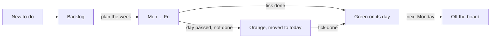
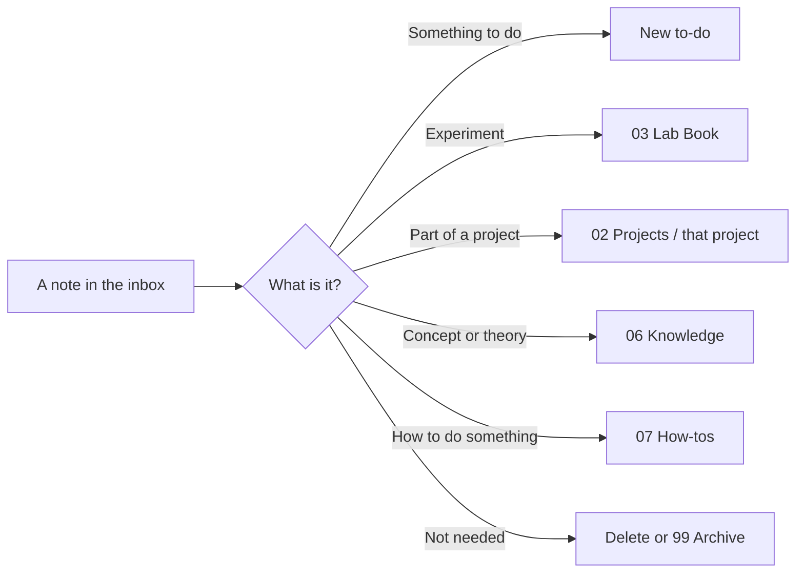

```vault-card
show: back-to-hub
```

> [!focus] The whole idea in one minute
> - **Start every day on [[00 Home]].** It shows what matters today and nothing else.
> - **Capture first, sort later.** Anything that pops into your head goes into the inbox with **Quick capture** (`Alt+N`). You sort it on Friday.
> - **Every to-do is a card on the board.** You plan by dragging cards onto days. Tick **done** when it's finished; anything unfinished follows you to the next day.
> - **Experiments and papers move through stages.** The homepage shows the ones that need you.
> - **Fridays tidy, meetings report.** Two short routines keep everything from piling up.

## Every day

> [!planning] Morning (2 minutes)
> 1. Open Obsidian. The homepage opens by itself (or press `Alt+H`).
> 2. Look at **This week**. Red *overdue* badges first, then anything tagged *today*. Amber *carried over* = it rolled over from an earlier day.
> 3. Press **Today's note** (`Alt+D`) if you want somewhere to jot down what happens.

> [!tip] During the day
> | I want to... | Do this |
> |---|---|
> | Note down a thought quickly | **Quick capture** (`Alt+N`) - it goes to the inbox |
> | Remember to do something | **New to-do** (`Alt+T`) - type it, press Enter, pick a project (or "(no project)"), what it **comes after** (only asked in a project with open to-dos), a due date (Enter = none; `fri`, `tomorrow` and `next mon` work too) and a priority. Esc cancels. Started from a project? It picks the project for you. Or press **New** in a day's column on the board - it lands on that day |
> | Start an experiment | **New lab entry** (`Alt+L`) - it numbers itself and asks for a title |
> | Find anything | **Search** (`Alt+F`) |
> | Make a note for a paper | `Ctrl+P`, then **ZotLit: Create literature note** |
> | Need to order something | **Add to shopping** - type items, commas between them |
> | Clear the inbox | **Sort inbox** (under *This week*) - takes a minute when it's short |
> | Mark something finished | Click the **circle** on its card on the [[To-do board.base\|To-do board]] - the card turns green. Click again to undo |

> [!summary] End of the day
> - Your daily note's *Today in the vault* already lists what you worked on - nothing to write up.

## To-dos



- Every to-do starts in **Backlog**. Drag it onto a day when you plan to do it. Today's column is **blue**. To add one straight onto a day, press **New** in that day's column.
- Finished? Click the **circle** on the card (top right). The card turns **green** and stays on its day for the rest of the week, so you can see what you got through. On Monday it leaves the board by itself.
- Didn't get to it? Do nothing. Next time Obsidian opens, it moves to **today** and turns **orange** - no lost tasks. Drag it somewhere else if today isn't right, or back to Backlog.
- A day that has passed this week (its name greyed) takes no cards: drop on today or a later day. A card planned after this week waits in the Backlog with its date (`Tue 27 Oct`).
- Only give it a **due** date if there's a real deadline - those show in red when they're late. New to-do asks for one (Enter = none). With Settings → Lab Kit → **Due-date countdown** on, every card with a due date shows the days left (`3d`, `Today`, `2d late`).
- Tick **meeting** on a to-do (open the note) if you want to raise it at the next meeting.
- A card with a priority or a project shows a small tag at the bottom left, like `↑ Polymers` (↑ high, – medium, ↓ low). In each column done cards go last, then the highest priority comes first.
- A long name shows on one line on a card with a tag or a countdown (up to 3 lines on a plain card) - open the card to see the rest.
- Today's column not blue? The planning kit must be on and its files installed (Settings → Lab Kit → Updates).

## Experiments

- **New lab entry** creates `0015 - Title` in the lab book.
- Move it along the [[Lab book base.base|Experiments]] board as it goes: **Planned -> Started -> Processing results -> Closed**.
- Link the papers it builds on in **Based on** - they show the experiment under *Used in experiments*.
- Anything not *Closed* shows on the homepage under *Experiments on the go* (the tile heading opens the board).
- The columns are coloured by status (Settings → Lab Kit → **Colour board columns**, with a colour for each).
- The base has a second view, **All experiments**, a list that also shows old closed ones.
- Switch on **Checklist progress** in Settings → Lab Kit and a card shows a bar for the ticked check boxes in the note (`progress: 3/7`).

## Projects

- [[Projects overview]] (**Projects** on the homepage) has a **card for each project**: its goal, next to-dos, how many papers and notes, and buttons for **New note**, **New to-do** and **Open**.
- **New note** on a card (or on a hub) puts the note straight into that project's folder - no filing later.
- **New project** asks for a name and makes the folder and hub in `02 Projects`. Then make a Zotero collection with the **same name** under `Projects/`, and write the hub's one-line **goal**.
- Each hub lists the project's to-dos, notes, papers and meetings by itself - give a to-do the project, keep notes in the folder, drag papers into the collection, set **project** on a meeting note. To-dos and notes show 10 rows, meetings the last 8; **Show all** shows the rest.
- The row at the top of a hub has a link back to [[Projects overview]], **New to-do**, **New note**, the **Status** drop-down (Active, Paused, Done) and the **Deadline** date.
- Give a hub a **deadline** date and, with Due-date countdown on, it shows `deadline 5d` on the hub, its card and the homepage (gone when the project is Done).
- A note made with **New note** links to its project and starts with a link back to the hub.

> [!planning] The project plan
> - When one to-do has to wait for another, say so: **New to-do** asks *Comes after?*, or drag on the hub's **plan map**. The map shows the to-dos as cards joined by arrows; a to-do is **blocked** (dashed) until everything before it is done.
> - On the map: click a card to open it, click its circle to tick it. Hover a card and drag the dot onto another card to make that one come after it. Drag the whole card by the strip on its left edge onto another card to make it a subtask; open the "▸ n/m" list and drag a line out onto the map background (or right-click it, **Remove from parent**) to undo that. Click an arrow, then **Remove link**, to undo a link. Right-click a card for **Mark done** and **Delete note**. A notice offers **Undo** each time, and the **↶ ↷** buttons by the zoom buttons undo and redo the last 20 changes made on the map (including ticks) (Ctrl/Cmd+Z does not do this).
> - The ⇄ / ⇅ button by the title turns the map from left-to-right to top-to-bottom. **−**, **+** and **Fit** make it smaller or larger. The ↺ button after them puts the map back to its default view.
> - The image button (desktop only) copies a picture of the plan for your weekly slides: pick the layout, check the preview, press **Copy picture**, paste it into the slide.
> - Finished a step? **Add result** (command palette, with the to-do open) writes one line that shows on its card as `→ result`.
> - Have the steps as a list of `[[to-do]]` links in a note? Select them and run **Link to-dos in order**.
> - A to-do with `experiment` set to a lab note shows that experiment's status on its card, and the hub's **Experiments** tile lists those lab notes. A to-do with `sub` set to another to-do is its subtask (the parent's card shows `1/2`). Both are typed in the to-do's properties.

## Reading papers

> [!note] Highlight colours in Zotero - just three
> `1` **Yellow** key point - `2` **Red** disagree, confused or a question - `3` **Green** something to try in the lab. Anything else goes under *Other highlights*.
> Want to add your own words? Add a **comment** to the highlight. Want to find it by topic later? Give the highlight a **tag**.

1. Read and highlight in **Zotero**. Drag the paper into its **project collection** (under `Projects/` - it can be in more than one), and tag it `key-paper` if it's important.
2. In Obsidian, run **ZotLit: Create literature note** and pick the paper. Highlighted more later? Press the **update** button on the note.
3. When you have 5 minutes, write **one line** after `takeaway::` - what the paper says. Then, in *For my projects*, finish each line - why it matters to that project. That's it - the paper is processed.
4. [[Literature]] shows what's still *to process*, your key papers and ideas to try. [[Projects overview]] shows key papers grouped by project, and each project hub lists its papers.

> [!tip] Linking a paper
> - Whole paper: type `[[` and part of its title.
> - One finding: type `[[citekey#^` and pick the highlight. Use `![[...]]` to show it inside a lab entry.

> [!warning] Don't write between the `%%zt-managed%%` markers
> The update button rewrites that part. Write in the *Takeaway* and *For my projects* boxes at the top or under *My notes* at the bottom.

## Meetings

- [[Meetings]] has a **card per series** (next date, how often, notes held). A series can be weekly, fortnightly, monthly or **every N weeks**.
- **Extra meeting now** on a card makes an in-between meeting on a date you choose; the schedule doesn't move.
- **New one-off meeting** is for a meeting that belongs to no series: it asks what it is about, the date and a project, and files it in the **One-off** hub.
- Set **project** on any meeting note to show it on that project's hub.
- **New meeting series** (command palette) asks for a name, how often, the day, the first date and the deck; its last box is an optional template note for that series' meeting notes (Enter = the kit's Meeting template).
- Hubs have one row of buttons at the top: a project, topic or series hub has a **back link** to the hub above it, a topic hub has **New concept**, a series hub has **Meeting deck**, **New meeting note** and **Extra meeting now**. A meeting note starts with a link back to its series and **Meeting deck**.

1. Before a meeting, open [[Meetings]], and press **New meeting note** on your series' card.
2. It fills itself: experiments you touched, to-dos you ticked done, papers you read, and anything you flagged for the meeting.
3. Press **Meeting deck** (it opens the deck of the meeting you are in) and copy what you need onto your slides.
4. After the meeting, note the outcomes and turn actions into to-dos.

## Snippets (Alt+S)

`Alt+S` in a lab note opens a menu of tables to insert: solutions, recipes, sample lists, NMR / GPC / DLS tables, combined results, flow column prep and more. Several are plain notes you can read and edit (in the Snippets folder). **Settings → Lab Kit → Manage files…** has **Make my own copy** on each, so you can change one without losing the original. **Settings → Lab Kit → Lab notebook → Snippet icons** sets each snippet's icon.

## Keeping the vault healthy

- **Check setup…** (Settings → Lab Kit) lists what the kits need and fixes it.
- **Check hotkeys…** shows the keys [[Hotkeys]] recommends and what is set; **Set the suggested keys…** there sets the ones that are free (it asks first and never changes a key you have).
- **Tidy up notes** finds notes that don't follow the vault's rules and fixes the ones you tick (it shows before and after, folds the lines that stay the same, shows a change that is the same in several notes once, and keeps a backup). An old project, topic or series hub gets the current buttons and tiles from the rule **Hubs: bring the page up to the current template** (not ticked until you tick it).
- **Manage files…** shows kit files with a newer version. On a file you keep as your own: **Compare…** shows both, **Use kit version…** swaps yours for the kit's (a backup is saved first), **Keep mine** leaves yours. **Clear old backups…** (Settings → Lab Kit) empties old ones.

## Friday review (15 minutes)

Open [[Weekly review]] (button **Weekly review** on the homepage) and work down the list:
1. Empty the inbox - press **Sort inbox**. Each note opens, you pick where it goes (to-do, project, knowledge, how-to, meetings, archive or delete). In a folder list, type a new name to make a new folder. Esc stops at any point.
2. Close finished experiments.
3. Plan next week - drag to-dos from Backlog onto days (Mon-Thu mean *next* week when you plan on a Friday).
4. Process one paper.
5. Flag anything for the next meeting.
6. First Friday of the month: **Archive old to-dos** (anything finished over 30 days ago; a project's to-dos stay until the project is Done).

Then press **Start a new review**.

## Where does a note go?

**Sort inbox** asks this for every note in turn:



## Shopping list

[[Shopping list]] is for things to order or buy for the lab. Add items from anywhere with **Add to shopping**, tick them off when they're ordered, then press **Clear ticked**.

## Shortcuts

One rule: **Alt + the first letter** of what you want. The full list, and how to set them, is in [[Hotkeys]].

## Commands

Press **Ctrl/Cmd + P**, type part of the name. Many are also buttons on the homepage and the hubs.

| Command | What it does |
|---|---|
| New to-do | Makes a to-do on the Backlog (asks the project and a due date) |
| Quick capture | Makes an empty note in the inbox and opens it |
| Add to shopping list | Adds items (commas between them) to the [[Shopping list]] |
| Sort inbox | Goes through the inbox one note at a time and files each |
| Archive old to-dos | Moves to-dos finished over 30 days ago to the archive, except those of a project that is not Done |
| Open to-do board | Opens the [[To-do board.base\|To-do board]] |
| New meeting | New meeting note for a series (asks which when there are several) |
| Freeze this meeting note | Turns a meeting note's lists into plain links, so it stays a record (New meeting does this to the last one) |
| New extra meeting now | An in-between meeting on a date you choose |
| New one-off meeting | A meeting that belongs to no series |
| New meeting series | Makes a series: name, how often, day, first date, deck, template |
| Open meeting deck | Opens the deck of the meeting you are in (asks only from other notes) |
| New project | Makes a project folder and its hub |
| Add result | Sets the one-line result of the to-do you have open; the project plan shows it as `→ result` on the card |
| Link to-dos in order | Select a list of `[[to-do]]` links in a note: each to-do then comes after the one before it (asks first, with Undo afterwards) |
| New project note | Makes a note in a project's folder |
| New concept | Makes a knowledge note in a topic |
| New topic hub | Makes the hub note of a topic folder |
| New lab entry | Makes a lab book entry from the Lab Book Template |
| New chemical | Makes a chemical note (asks the name, then the class) |
| New rig | Makes a rig note from the Rig template in your Rigs folder (asks the name) |
| Insert snippet | The Alt+S menu: Recent, then the snippets by group; type to search. Needs Templater for now |
| Clone experiment | Copies a lab note (the open one, or pick) into a new numbered lab note: set-up kept, sample codes renumbered, status, dates, results and notes started again, with a `Cloned from` link back |
| Insert empty calc block | A blank calc table at the cursor |
| Insert lab header block | The hazard / data-folder header at the cursor |
| Tidy up notes | Finds notes that don't follow the vault's rules and fixes the ones you tick |
| Find moved folders | Points the settings at folders you moved outside Obsidian |
| Check setup | Lists what the kits need and fixes it |
| Check hotkeys | Shows the recommended keys and what is set; can set the free ones after asking |
| Review kit files | Preview of every kit file the plugin would add or update |
| Manage kit files | Every kit file with its status and buttons (Compare, Use kit version, Keep mine) |
| Show what's new | The newest changes of Lab Kit |

## When something looks wrong

- Buttons, boards and lists are explained in detail in the [[Vault spec]] - share it with Claude when asking for changes.
- Most things fix themselves if you close and reopen the note.
- Works on one computer but not the other? Check [[Setting up a computer]].
