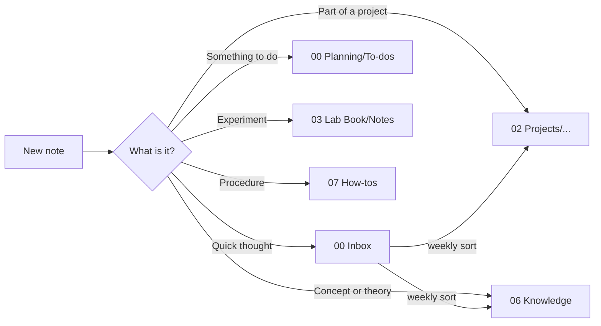
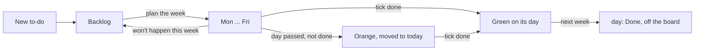
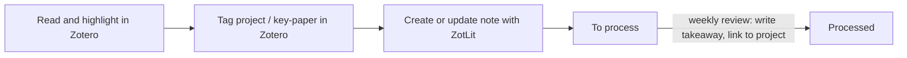

```vault-card
show: back-to-hub
```

> [!focus] Read this first
> The everyday user guide is [[How my vault works]] (the **How it works** button on the homepage). This note is the technical source of truth for how this vault is organised and how it looks. Any future change (by me or by Claude) should follow it, and update it if a rule changes. Share this note at the start of a session about the vault.

## Principles

> [!tip] Designed for focus
> - **One place for everything.** Every note has exactly one home folder. Other places link to it.
> - **Fixed order.** Top-level folders are numbered so they never move around.
> - **Small focus.** The homepage shows today's to-dos and what's overdue - never the whole backlog.
> - **Buttons over menus.** Common actions are one click on [[00 Home]].
> - **Data lives in properties.** Boards, lists and the homepage read note properties, so dragging a card or picking a value updates everything.
> - **Same colour = same meaning**, everywhere (see [[#Visual theme]]).

## Folder structure

| Folder | What goes here |
|---|---|
| `00 Home.md` | The homepage. Opens on startup via Notebook Navigator's homepage setting. |
| `00 Inbox/` | Quick captures and AI chats. Sort weekly. |
| `00 Planning/` | `To-dos/` (one note per to-do), `To-do board.base`, [[Weekly review]] and [[Shopping list]]. |
| `01 Daily Notes/` | Daily notes, by year. A log of the day, not a to-do list. |
| `02 Projects/` | One subfolder per project, each with a hub note. Plans, progress, decisions, paper drafts. |
| `03 Lab Book/` | `Notes/` = numbered lab entries (`0014 - Title`), `Rigs/` = one note per flow rig (the lab kit's Rigs folder), plus `Lab book base.base`. |
| `04 Literature/` | `ZotLit Imports/` (one ZotLit note per paper, named by citekey; `ZotLit attachments/` holds highlight images) and the [[Literature]] hub. Key papers are tagged `key-paper` in Zotero. |
| `05 Chemicals/` | Chemical database notes and base. |
| `06 Knowledge/` | Concepts and theory, by topic subfolder. Index: [[Knowledge index]]. |
| `07 How-tos/` | Procedures and software tips, by topic subfolder. Index: [[How-tos index]]. |
| `08 Meetings/` | The [[Meetings]] hub, then one folder per meeting series with its hub note and meeting notes (one-off meetings in `One-off`). |
| `Extras/` | Templates, scripts, attachments. The kit's own files here are managed by Lab Kit (Settings > Lab Kit > Manage files). |
| `99 Archive/` | Anything finished or retired. Never deleted outright. |

These are the default names. Each folder is a setting (Settings > Lab Kit > Planning > Planning folders, and Lab notebook for the Lab notes, Chemical and Rigs folders); rename a folder inside Obsidian and its setting follows.

> [!question] Project, Knowledge or How-to?
> - **Project** - notes about *doing* something with an end point.
> - **Knowledge** - notes about *what's true*; reusable across projects.
> - **How-to** - notes about *how to do a task*, step by step.
>
> A concept used by a project lives in Knowledge; the project hub links to it.

**Knowledge notes** are made with the **New concept** command (template `Extras/Templates/New concept.md`): it asks for the title and the topic (an existing topic, or type a new one), then files the note as `06 Knowledge/<Topic>/<Title>.md`. The **New concept** button on a topic hub skips the topic question.

| Property | Value | Set by |
|---|---|---|
| `kind` | `concept` (a comparison is a concept note with a table) | template |
| `summary` | one line saying what the note is | me |
| `sources` | links or references that back it up | me |
| `checked` | `false`; `true` once checked against the sources | template / me |
| `cssclasses` | `[vt]` | template |

Sections use `##` (`What it is`, `Why it matters`, `Related`), never `###`. A topic hub is the index note of a topic folder, with `kind: hub`, named like the folder. Make one with the **New topic hub** command. [[Knowledge index]] lists every topic. Tidy up notes lists concept notes with `###` headings or no summary / sources.



## Note types and properties

> [!warning] Property naming
> - `Status` (capital S, plain text, one value) is the **only** status property in the vault. Never create a lowercase `status`.
> - `kind` marks system notes: `project`, `todo`, `literature`, `meeting`, `meeting-series`, `concept`, `review`, `hub`, `daily`, `guide`, `list`, `spec`. (Not `type` - that clashes with the lab book's `Type`.)
> - Exception: literature notes have no `Status`. Their state is the inline field `[takeaway:: ...]` (empty = to process), because ZotLit refreshes the properties on every update (see below).
> - Lab book properties keep the lab kit's names (`Type`, `Exp. Class`, `Plan date`, ...).
> - Two lab note properties are written by a command or snippet, not by the template, so a note without them is normal and Tidy up notes never adds them: `Rig` (the Rig snippet, a link to the rig note) and `Cloned from` (Clone experiment, a link to the note it was copied from).

### Lab entry (`03 Lab Book/Notes`)
Created with the **New lab entry** command, or by making a note in the folder (a Templater folder template), from the lab kit's *Lab Book Template* (numbering + title prompt).

| Property | Values |
|---|---|
| `Status` | `Planned` -> `Started` -> `Processing results` -> `Closed` |
| `Based on` | links to the papers (citekeys) the experiment builds on |
| `Rig` | link to the rig note, set by the Alt+S **Rig** snippet |
| `progress` | ticked / all check boxes, e.g. `3/7`; written by the plugin when Settings > Lab Kit > Checklist progress is on (also on the Shopping list) |
| `cssclasses` | includes `vt` |

Any link from a lab entry to a paper - in `Based on` or in the text - shows up on that paper's note under *Used in experiments*.

### Project hub (`02 Projects/<Project>/<Project>.md`)
The hub note has the same name as its folder (a Notebook Navigator folder note) - no exceptions, because paper notes link to projects by that name. The Zotero collection for the project (`Projects/<Project>`) has the same name too.

| Property | Values |
|---|---|
| `kind` | `project` |
| `Status` | `Active`, `Paused`, `Done` - picked with the drop-down in the hub's top row |
| `deadline` | date (`YYYY-MM-DD`), optional, set with the date box in the top row - counted down like a to-do's `due` (needs Settings > Lab Kit > Due-date countdown); none once `Status` is `Done` |
| `cssclasses` | `vt`, `project` |
| `goal` | inline field in the *Goal* box - one line, what finishing looks like |

Created with the **New project** button or command (template `Extras/Templates/Project hub.md`): asks for the name, makes `02 Projects/<Name>/` and the hub inside it. Every hub has the same layout:

| Section | What it shows |
|---|---|
| Top row (`show: hub-bar`) | no `# heading` (Obsidian's inline title is the title); back link to [[Projects overview]]; **New to-do**; **New note**; the Status drop-down; the Deadline date; the countdown |
| *Plan* (`show: project-plan`) | only when a to-do of the project has `after` or `order`: ready to-dos, then blocked ones (`after X`; blocked = anything earlier in the chain is still open), finished ones with their `result` behind **Show all**. Drawn only on a hub without the map block (a hub with the map shows the map only) |
| *Plan map* (`show: project-map`) | always (a project with no to-dos shows a box, **+ New to-do for this project**, that opens New to-do for it; the Plan list needs a link; the map does not: unlinked to-dos wait in the **Not linked** tiles, where you drag them into the plan): to-dos with a link as cards joined by arrows (title, due date, priority, `→ result`; finished faded, blocked dashed); click opens, the circle ticks and unticks, drag from anywhere on an arrow onto a to-do to put that to-do between the two (click an arrow for its menu: Insert a to-do here…, Remove link), right-click: Open, Open in new tab, Mark done / Mark not done, Delete note; hover marks everything before and after; long arrows are routed around the cards between (not behind them); the ⇄ / ⇅ button by the title flips the map between left to right and top to bottom for the open note (default: Settings > Lab Kit > **Project plan map direction**); hover a card and drag the dot that appears onto another card (or a **Not linked** row) to make that to-do come after it, click an arrow then **Remove link** to remove one (both write `after`, both have Undo in a notice; the ↶ ↷ buttons by − + Fit undo and redo the last 20 changes made on the map (links, removed links, subtasks, ticks), kept in memory per hub until Obsidian closes, a value changed by hand since is left alone; Ctrl/Cmd+Z does not do this); the strip on a card's left edge (a thin bar, a ⋮⋮ grip on hover, always shown on touch) drags the whole card onto another card to write `sub` (one level only; the card then lives in its parent's "▸ n/m" list, a to-do that comes after it gets a dashed arrow to the parent card), and a line of that list dragged onto the map background, or right-clicked and **Remove from parent**, clears `sub` (Undo in a notice); a **Not linked** to-do is a small tile (title cut with …, the full name on hover, a tick circle, a "▸ n/m" badge that opens its subtask list as a floating box) with the same strip on the left and "comes after" dot at the right; to-dos with no links sit in a **Not linked** grid of tiles under it Buttons by the title: flip direction, − / + / Fit (zoom, not remembered), ↺ reset (zoom, direction and card positions back to the default), and on desktop an image button that opens a window to copy a 16:9 PNG of the plan for a slide (always light; layout: finished and later to-dos as tiles with the next N columns as cards, or the whole map). |
| *Goal* | `[goal:: ...]` - also shown on the project's card |
| *To-dos* (`show: project-todos`) | open to-dos whose `project` is this hub: overdue first, then by day, then by `priority` (1 first, empty last), then by name; 10 rows, **Show all** |
| *Notes* (`show: project-notes`) | every note in the project folder (and subfolders), newest first; 10 rows, **Show all** |
| *Experiments* (`show: project-experiments`) | the lab notes that this project's to-dos name in `experiment`, each once, with its `Status` and the to-do that names it; open ones first, Closed last; nothing is written to the lab notes (a lab note has no `project`); needs the Lab folder set |
| *Meetings* (`show: project-meetings`) | meeting notes whose `project` names this hub, newest first; the last 8, **Show all** |
| *Papers* | every paper in the Zotero collection `Projects/<Project>` **or** linking this hub, key papers first (&#9733;), with my reason from its *For my projects* line (Dataview) |
| *Done to-dos* | collapsed (Dataview) |
| `## Related` | links I add by hand (concepts, how-tos); anything else project-specific goes below it |

**Changing the plan.** `after` is written by *Comes after?* at New to-do, by dragging on the map, by the command **Link to-dos in order** (select a list of `[[to-do]]` links in a note: each to-do gets `after` naming the one before it; preview, then confirm; pairs already linked or that would make a loop are left out) or by hand. `result` is written by the command **Add result** or by hand; `order`, `sub` and `experiment` by hand. Deleting a to-do (the map's Delete note, or anywhere in Obsidian) passes its `after` on: A → B → C becomes A → C, with Undo in a notice; moving a to-do to the archive changes nothing.

**New note in a project** (**New project note**, template `Extras/Templates/New project note.md`) files the note in the project's folder: the folder of the card it was pressed on, else the project you're in, else it asks which project. Then it asks for the title. The note gets `project: [[<hub>]]` and starts with a back link to the hub (`show: back-to-project`).

An older hub gets the current layout from **Tidy up notes** > *Hubs: bring the page up to the current template* (it keeps the goal and what is under Related; never ticked by default).

### Projects overview ([[Projects overview]], `02 Projects`)
**New project** button, then **one card per project** (two per row, Active first), then **Key papers by project** (from `Collections`, so a paper in several projects appears under each, with its takeaway). Homepage button **Projects** (`go-projects`).

Each card shows: name + status badge, the goal, the next 3 open to-dos (overdue first, "+ N more"), counts of open to-dos / papers / notes, and three buttons - **New note** (straight into that project's folder), **New to-do**, **Open**.

> [!note] The cards are drawn by Lab Kit
> Meta Bind buttons can't be generated per project, so Lab Kit draws the cards (a `vault-projects` block, styled by `vault-theme.css`). Their buttons call Lab Kit's New project note and New to-do. With a `deadline` and the countdown on, a card shows the days left.

### To-do (`00 Planning/To-dos`)
Created with the **New to-do** button or command (`Alt+T`): an entry window (title box, chips for Project, Meeting, Due, Priority; Enter creates; the countdown badge is a setting for all to-dos), then the template `Extras/Templates/To-do.md` makes the note from what was set (it writes a `todo-bar` block, the chip bar, under the properties; Tidy up notes can add it to old to-dos). **New** in a column on the board runs the same template, which opens the same window through the plugin (its title names the column; without the plugin the template asks the questions one by one). A Templater **folder template** (`00 Planning/To-dos` -> `To-do.md`) runs the template for board cards too, and the template keeps the column's `day` (anything else starts in `Backlog`).

| Property | Values | Set by |
|---|---|---|
| `kind` | `todo` | template |
| `day` | `Backlog`, `Mon`, `Tue`, `Wed`, `Thu`, `Fri` (`Done` = finished in an earlier week, off the board) | dragging the card |
| `done` | tick box - finished | me |
| `planned` | date the card was put on its day | Lab Kit |
| `rolled` | tick box - carried over from an earlier day (orange card) | Lab Kit |
| `done_on` | date `done` was ticked | Lab Kit |
| `project` | link to a project hub, e.g. `"[[Flow rig]]"`, or empty | template / me |
| `due` | date (`YYYY-MM-DD`), optional - only for real deadlines | template / me |
| `priority` / `project` on the board | the board card shows a small tag at the bottom left, `↑ Polymers` (an arrow for priority 1, 2 or 3: ↑, –, ↓, and the project's name); read from the note, so the property row need not be shown on the card | plugin |
| `countdown` | tick box - show days left until `due` on the board card (needs Settings > Lab Kit > Due-date countdown) | template / me |
| `priority` | `1`, `2` or `3` (1 = highest, a number property) or empty - in a project hub's To-dos tile and cards, to-dos on the same day are ordered 1, 2, 3, then none; the board sorts each column the same way, after putting done cards last (`sort:` in `To-do board.base`) | template (New to-do asks it) / me |
| `sub` | optional, by hand: one link to the to-do this one is a subtask of (`"[[Parent to-do]]"`); the parent's card on the plan map shows a count (`1/2`) that opens the list; the parent is never ticked for you; one level only; the subtask stays an ordinary to-do (board, `after`) | me |
| `experiment` | optional, by hand: one link to the lab note this to-do runs (`"[[ABC0014-A]]"`); the project plan shows that note's `Status` as a badge on the to-do's card. Display only; needs the Lab folder set | me |
| `after`, `result`, `order` | for a to-do in a project: `after` = link(s) to the to-dos that come first (New to-do's *Comes after?* writes one; dragging on the plan map and Link to-dos in order write it too; a second one by hand, as a list), `result` = one line (the Add result command, or by hand), `order` = a number, by hand; read by the project hub's plan map and Plan list | template / plugin / me |
| `meeting` | link to a meeting series, e.g. `"[[Group meeting]]"` - raise this at its next meeting; `false` = not flagged | template / me |

The template always files the to-do in `00 Planning/To-dos`, wherever it was started from. It asks, in order: the text; the project (filled in by itself when started from a project card on [[Projects overview]], from a project hub, or from any note inside a project folder; "(no project)" for none); *Comes after?* (only for a project with other open to-dos: one pick, "(nothing)" first); which meeting to raise it at (only when there are several series); a due date (Enter = none; `YYYY-MM-DD`, or `today`, `tomorrow`, a weekday such as `fri`, `next mon`) and, with a date, whether to show a countdown; the priority (none, 1, 2, 3). Esc at any box cancels the to-do, except at *Comes after?*, where it picks nothing. New to-dos get `cssclasses: [vt]`.

**Roll-over** is done by Lab Kit itself (no Templater startup template), when the planning kit is on and installed: about 90 seconds after Obsidian opens, and again when the date changes while Obsidian stays open. The command **Roll over to-dos now** runs it at once.
- A card's day means *the first such weekday on or after `planned`*. So a card dragged onto Mon on a Friday waits for next Monday.
- Unfinished card whose day has passed -> moves to today's column (Mon at the weekend), `rolled: true`, shown **amber**.
- Ticked `done` (click the circle on the card) -> stays on its day, shown **green**, `done_on` stamped.
- Monday (first run of a new week) -> cards finished in an earlier week get `day: Done` and leave the board. They still count everywhere else (meeting note, daily note, hubs, archive).
- Dragging a card yourself stamps `planned` and clears `rolled`. Backlog cards never roll.
- No weekend column: weekend leftovers roll to Monday.
- Lab Kit also makes the circle on each card clickable, marks carried-over cards orange (`vt-rolled`), marks today's column (`body[data-vt-today]`) and puts the countdown on cards with a `due` date.
- Check it is running: today's column is blue. If not, check the planning kit is on and its files installed (Settings > Lab Kit > Updates); restart Obsidian.



### Literature note (`04 Literature/ZotLit Imports`)
Created by **ZotLit** (command *ZotLit: Create literature note*) from three Liquid templates in `Extras/Templates/ZotLit/`: `zotlit-note.liquid.md` (layout), `zotlit-content.liquid.md` (the managed region) and `zotlit-lititem.liquid.md` (one highlight). Refreshed with the **update-litnote** button, which runs *ZotLit: Update literature note*.

> [!warning] Only the managed region is rewritten
> ZotLit rewrites only what sits between `%%zt-managed%%` and `%%/zt-managed%%`, plus its own properties. The *Takeaway* box above it and *My notes* below it are never touched. Never write inside the markers.

**Note layout:** empty line - Takeaway box (`[takeaway:: ]`) - *For my projects* box - update button and PDF link - *managed region* - `## My notes`.

**For my projects** (`[!projects]` callout) is filled once, when the note is created: one line `- [[<Project>]]: ` for each Zotero collection under `Projects/` that the paper is in (or a placeholder line if none). I write after the colon how the paper helps that project. Updates don't touch this box.

**Which projects a paper belongs to** comes from the `Collections` property (e.g. `Projects/Flow rig`), refreshed from Zotero on every update. So a paper added to another project collection later shows on that hub after **Update literature note** - just without a reason until I add a line `- [[<Project>]]: why` to the box. A box line on its own (no collection) also counts.

**Managed region:** `## Key points`, `## To try`, `## Questions`, `## Other highlights` (each only if it has highlights), then collapsed `[!lab]` *Used in experiments* and `[!info]` *Abstract & related*. Each highlight appears once, as one line: text, *my Zotero comment*, Zotero tags as `#tags`, page link to the PDF, and a block ID (`^` + Zotero annotation key), so a lab entry can link one finding with `[[citekey#^key]]`.

**Properties** are set in Settings > ZotLit > Templates > Frontmatter (not in the template file):

| Property | Expression | Merge |
|---|---|---|
| `kind` | `"literature"` | Keep existing |
| `Type` | `"Literature Note"` | Keep existing |
| `Title` | `zt.title` | Replace |
| `aliases` | `zt.title \| split: "§§"` | Append arrays |
| `Year` | `zt.date.year` | Replace |
| `Authors` | `zt.authors \| join: ", "` | Replace |
| `Zotero Tags` | `zt.tags \| map: "name"` | Replace |
| `Collections` | `zt.collections \| collection_paths` | Replace |
| `citekey` | `zt.citationKey` | Replace |
| `URL` | `zt.url` | Keep existing |
| `DOI` | `zt.DOI` | Keep existing |
| `imported` | `"now" \| date: "%Y-%m-%d"` | Keep existing |
| `cssclasses` | `"vt,literature,wide" \| split: ","` | Keep existing |

`DOI` is for your own use (the kit reads no DOI); its expression is the one Zotero's field name suggests and has not been checked in ZotLit: if it stays empty, look the field name up in ZotLit's template data explorer. `zotero-key` is added by ZotLit itself and marks the note as a literature note. `imported` is the date the note was first created (queries fall back to `file.ctime`).

| Field | Where | Meaning |
|---|---|---|
| `Zotero Tags` | properties | `key-paper` and topic tags, set **in Zotero** |
| `takeaway` | inline field in the Takeaway box | one line in my own words - what the paper says; empty = still *to process* |
| project lines | *For my projects* box | why it matters to each project |

> [!tip] Organising papers - two separate decisions, both in Zotero
> - **Which project?** Put the paper in a collection under `Projects/` (it can be in several).
> - **Is it important?** Tag it `key-paper`.
> Projects are no longer Zotero *tags*.

Highlight colours (set in Zotero, keys `1` `2` `3` in Zotero's colour order): **yellow** `1` key point (-> Key points), **red** `2` (or magenta) disagree / confused / question (-> Questions), **green** `3` method or idea to try (-> To try; green = lab in the palette). Any other colour -> Other highlights. Zotero can't reorder its colours, so the meanings follow its key order. A Zotero **comment** on a highlight is my own words; a Zotero **tag** on a highlight becomes a `#tag`.



### Shopping list ([[Shopping list]], `00 Planning`)
One list of plain checkboxes, the one place checkboxes are used instead of to-do notes, because items are ordered, not planned. **Add to shopping** (homepage; the Lab Kit command **Add to shopping list**) asks for items (comma-separated) and adds them to the end; **Clear ticked** (Meta Bind `regexpReplaceInNote`) removes ticked items.

### Inbox (`00 Inbox`)
Everything captured quickly lands here (**Quick capture**, `Alt+N`). The homepage shows the count under *This week* with a **Sort inbox** button; the weekly review has the same button.

**Sort inbox** (a Lab Kit command; the button runs it) opens each inbox note in turn and asks where it goes, in a bar at the bottom of the window so the note stays readable:

| Choice | What happens |
|---|---|
| To-do | becomes a to-do (`kind: todo`, `day: Backlog`) in `00 Planning/To-dos` |
| Project... | moved into the chosen project's folder |
| Knowledge... / How-to... / Meetings... | moved into a chosen subfolder (or a new one: type its name) |
| Archive | moved to `99 Archive/Inbox` |
| Delete | asks to confirm, then sends it to the trash |
| Skip for now / Stop (Esc) | leaves it / ends the run |

Every move offers a rename first and goes through Obsidian, so links update.

### Meeting series and meeting notes (`08 Meetings/<series>`)
A meeting held regularly is a **series**: a folder under `08 Meetings` with a hub note of the same name. **New meeting series** (command, and a button on [[Meetings]]) asks the name, how often, the day, the date of the first meeting, the deck path for this computer and (optional) the name of a template note for its meeting notes.

| Property (series hub) | Values |
|---|---|
| `kind` | `meeting-series` |
| `interval` | `weekly`, `fortnightly`, `monthly` (the same weekday of the month as `start`), `every N weeks`, or `once` (the One-off hub) |
| `day` | `Mon` ... `Sun` |
| `start` | the date of a meeting (`YYYY-MM-DD`); dates are counted from it |
| `deck_windows` / `deck_mac` | where the deck is on each computer: a folder with all the decks in, or the path to one deck file |
| `template` | name of my own meeting note template; empty = the kit's **Meeting** template |

A meeting note is `YYYY-MM-DD <series name>`, created by **New meeting note** (command **New meeting**) for the series' next date.

| Property (meeting note) | Values |
|---|---|
| `kind` | `meeting` |
| `series` | link to the series hub |
| `date` | the meeting's date |
| `since` | the last meeting of the series, else one interval back - the start of the window the lists read |
| `project` | empty, a link or a list of links to project hubs - the note then shows on those hubs |

The note starts with a top row (`show: meeting-bar`: back link to its series, **Meeting deck**) and fills itself from `since` to `date`: experiments edited (`show: meeting-experiments`), to-dos ticked done that have a priority of 1, 2 or 3 and are not subtasks (`show: meeting-done`; a muted line says how many without a priority are left out), papers imported (`show: meeting-papers`), and the open to-dos whose `meeting` links this series (Dataview).

- **Extra meeting now** (series hub and card; command **New extra meeting now**) makes a meeting note on a date I give, in between; the schedule doesn't move.
- **New one-off meeting** is for a meeting that belongs to no series: it asks what it is about, the date and a project, and files `<date> <title>` in the `One-off` hub, from the smaller **One-off meeting** template.
- [[Meetings]] shows one card per series (`show: meeting-cards`): next date, how often, notes held, and its buttons. The homepage has a *Next meetings* tile.

The **Meeting deck** button works on Windows and Mac: it picks `deck_windows` or `deck_mac` from the series hub and opens that location with this computer's default app (desktop only). On a series hub or a meeting note it opens that series' deck; elsewhere it asks which series.

### Weekly review ([[Weekly review]])
Friday, 15 minutes: inbox, close experiments, plan next week, process one paper, meeting prep, and on the first Friday of the month archive to-dos finished more than 30 days ago (button; uses `done_on`, moves them to `99 Archive/To-dos`; a to-do whose project hub is not `Done` stays, because the project plan reads it).

### Daily note (`01 Daily Notes/YYYY/YYYY-MM-DD`)
Template: `Extras/Templates/Daily note.md`. Properties: `Type: Daily Note`, `kind: daily`, `Experiments`, `cssclasses: [vt]`.

| Section | What it shows |
|---|---|
| Buttons | **New to-do**, **To-do board** |
| *Planned for today* | open to-dos whose `day` matches that date's weekday, plus anything due on or before that date |
| *Notes* | free text - the log of the day |
| *Today in the vault* | lab entries edited, to-dos ticked done that day (`done_on`), papers imported on that date |

All queries use the note's **file name** as the date (`date(this.file.name)`), so a note made ahead of time from the calendar shows the right day. *Today in the vault* uses last-modified dates, so an entry edited again later moves to that later day.

> [!warning] Daily notes have no to-do checklist
> To-dos live on the board as notes. A checkbox in a daily note would not move anything on the board, so there would be two lists that disagree.

> [!tip] Every new daily note gets the template, whichever plugin creates it
> Notebook Navigator's calendar creates daily notes itself (not through the core Daily notes plugin). So the template is applied by **Templater folder templates**:
> - Settings > Templater > **Trigger Templater on new file creation**: on
> - **Folder templates**: `01 Daily Notes` -> `Extras/Templates/Daily note.md`
> - Notebook Navigator > Calendar: root folder `01 Daily Notes`, daily pattern `YYYY/YYYY-MM-DD`
>
> Templater only fills empty new files, so notes created by the core plugin are not filled twice. Templates use Templater syntax (`<% tp.file.title %>`), never core placeholders like `{{date}}`.

## Routines and shortcuts

| When | What |
|---|---|
| Every day | Homepage (`Alt+H`), capture with `Alt+N` (lands in `00 Inbox`), new to-do `Alt+T` |
| Before a meeting | **New meeting note**, copy into the deck, flagged to-dos |
| Friday | [[Weekly review]] |
| First Friday of the month | Archive old to-dos (button in the weekly review) |

### Hotkeys

> [!tip] One rule: `Alt` + the first letter of what you want
> The recommended keys are in [[Hotkeys]]. They are suggestions: nothing is set until I do it, in Obsidian → Settings → Hotkeys or with **Set the suggested keys…** in **Check hotkeys…** (Settings > Lab Kit), which shows which are set, sets only commands with no key whose suggested key is free, and asks first.

Every key (the Alt + letter keys, the editing keys and the rules) is in [[Hotkeys]], and only there. In Zotero: `1` `2` `3` pick the highlight colour (see [[#Literature note (`04 Literature/ZotLit Imports`)|Literature note]]).

## Visual theme

| Setting | Value |
|---|---|
| Base theme | Obsidian default |
| Snippets | `vault-colours.css` - **the only file to edit for colour**: palette, text shades for light and dark mode, meanings, and dials (card fill, borders, tints, hint text). `vault-theme.css` - the look; it reads the names in `vault-colours.css` and sets no colours itself. `scrolling-mermaid.css` belongs to the lab kit. |
| Headings | H1 normal text, H2 amber, H3 blue, H4 green (red is kept for overdue) |
| Links | internal blue, external purple, amber on hover; plain text inside `vt` cards |
| Reading | every note 1200px wide (set in `vault-theme.css`, no class needed), line height 1.7, cursor line tinted blue |
| Icons | Lucide names only (same set as Obsidian and Meta Bind) |

> [!note] Palette - same colour, same meaning
> | Colour | RGB | Means | Used for |
> |---|---|---|---|
> | Blue | `59, 130, 246` | doing now | `[!focus]`, `Started`, today's column on the board |
> | Purple | `139, 92, 246` | projects | `[!projects]`, project hubs |
> | Amber | `245, 158, 11` | planning, waiting | `[!planning]`, `Processing results`, carried-over to-dos |
> | Green | `16, 185, 129` | lab, finished | `[!lab]`, `Closed`, done to-dos |
> | Slate | `100, 116, 139` | not started, navigation | `[!goto]`, `Planned`, `Backlog` |
> | Red | `239, 68, 68` | overdue **only** | `[!overdue]` |

**Boards** use Obsidian's **built-in kanban** view in Bases (Bases Board is no longer used - it didn't keep empty columns). Column order is `groupOrder` in the `.base` file. Colours come from `vault-theme.css`, **by column name**: Lab Kit writes each column's name into `data-vt-group`, so renaming a column value means updating the theme. Without the planning kit, Lab Kit colours the status columns itself (Settings > Lab Kit > **Colour board columns**, with a colour for each status). View names (`Board`) still matter for the to-do cards.
- Experiments: `Planned` slate, `Started` blue, `Processing results` amber, `Closed` green. Closed entries leave the board after 30 days; the base's second view, *All experiments*, lists every one. With Settings > Lab Kit > **Checklist progress** on, a card shows `progress` as a bar.
- To-dos: `Backlog` slate; Mon-Fri alternate two neutral shades so the days read as separate bands; **today's column blue**. Cards: **green** = done, **amber** = carried over.

**To-do cards** show only the title and `done` (view `order:` in `To-do board.base`) - every extra property makes every card taller. Each column is sorted done last, then by `priority` (view `sort:`). The priority and project tag sits at the bottom left (`data-vt-tag`, `data-vt-prio`). The due-date countdown is a small badge at the bottom right of the card (`data-vt-due`), not a property row.
- The title wraps onto up to 3 lines, then "..."; on a card with a tag or a countdown it is one line, so it stays clear of the bottom row. The tick circle sits top right; **clicking it ticks `done`** (Lab Kit handles the click, because Bases cards are read-only). Clicking anywhere else opens the note.
- Cards are a **fixed 88px**: Bases works out card heights itself and places each part with inline styles (`top`, `height`), so the CSS overrides those with `!important` rather than changing the height.
- Card HTML, for future CSS: `.bases-kanban-card` > `.bases-kanban-card-property.mod-title[data-property="file.name"]` and `.bases-kanban-card-property[data-property="note.done"]`, each with a `.bases-kanban-card-label` and `.bases-kanban-card-line`. A ticked box renders an `input:checked`.
- Green comes from `done` in the card; amber from a `vt-rolled` class Lab Kit adds (no `rolled` row needed on the card).

**Vault callouts** (defined in `vault-theme.css`): `[!focus]`, `[!projects]`, `[!planning]`, `[!lab]`, `[!goto]`, `[!overdue]`, `[!summary]`, `[!question]`, `[!comment]`, and `[!columns]` (the callouts inside it sit side by side, **at most 2 per row**, equal height). Standard Obsidian callouts (`note`, `tip`, `warning`, ...) are fine in ordinary notes.

**The vault look** comes from the `vt` css class. Every note made by a template or script gets `cssclasses: [vt]`: homepage, hubs, meetings, review, literature and lab notes.

## Homepage ([[00 Home]])

1. Date heading, with **How it works** at the right-hand end - opens [[How my vault works]]
2. Action buttons: Today's note, New to-do, New lab entry, Quick capture, Add to shopping, Search
3. Go to (a `vault-goto` block): one button per top-level folder that has a hub note or a base (named after the folder: To-do for the planning folder, Projects, Lab Book, Literature, Chemicals, Knowledge, How-tos, Meetings), plus the `extra:` lines (Weekly review, Shopping list; `Label | target | icon`)
4. Five tiles (`vault-card` blocks), two per row: **This week** (open to-dos: overdue first, then by day; today's are tagged, carried-over ones tagged amber; inbox count below) - **Experiments on the go** - **Projects** - **Recently read** (last 5 imports) - **Next meetings**. Each heading opens its board or hub. A tile shows at most 8 rows unless its block has `limit:`, with **Show all** / **Show the last N** when there are more

The tiles and the Go to bar are drawn by Lab Kit, follow the folder settings and redraw when notes change.

> [!note] The vault look (homepage and every `vt` note)
> - Flat cards: one neutral border, rounded corners, quiet grey title with a faint icon. The **only** coloured card border is the blue `[!focus]` callout.
> - Lists are plain rows with dividers - no bullets, no tables.
> - Colour appears only in **status badges** (`vt-badge` + `vt-<status>` classes in `vault-theme.css`), using the palette above.
> - Buttons are separate outlined pills, all neutral.
> - Opens in **Reading view** (`obsidianUIMode: preview`, via the Force note view mode plugin). Press `Ctrl+E` to edit.

> [!tip] Button templates (Settings > Meta Bind > Button templates)
> Check setup lists the kit's buttons that are missing or do something else than the kit's, with a Fix; restart Obsidian afterwards (Meta Bind loads its buttons at start-up).
>
> | id | Label | Action |
> |---|---|---|
> | `today` · `todo` · `lab` · `capture` · `search` | Today's note · New to-do · New lab entry · Quick capture · Search | commands (Daily notes, Lab Kit, Lab Kit, Lab Kit, Omnisearch) |
> | `shop-add` · `shop-clear` | Add to shopping · Clear ticked | Lab Kit command · removes ticked lines in the note |
> | `sort-inbox` · `archive-todos` | Sort inbox · Archive old to-dos | Lab Kit commands |
> | `new-project` · `project-note` | New project · New note | Lab Kit commands |
> | `new-meeting-series` · `new-meeting` · `new-one-off-meeting` · `go-deck` | New meeting series · New meeting note · New one-off meeting · Meeting deck | Lab Kit commands |
> | `go-todo` · `go-lab` · `go-projects` · `go-lit` · `go-chem` · `go-know` · `go-howto` · `go-meetings` · `go-review` · `go-shop` | To-do board · Experiments · Projects · Literature · Chemicals · Knowledge · How-tos · Meetings · Weekly review · Shopping list | open that note or base |
> | `help` | How it works | open `[[How my vault works]]` |
> | `clear-review` | Start a new review | unticks the review's boxes |
> | `update-litnote` | Update literature note | ZotLit command |

## Plugins and their jobs

| Plugin | Job |
|---|---|
| Notebook Navigator | Sidebar, folder notes, homepage on startup |
| Force note view mode | Opens notes with `obsidianUIMode: preview` in Reading view (homepage) |
| Meta Bind | Buttons (as button templates) and inputs (homepage, hub status) |
| Dataview | Lists Lab Kit doesn't draw itself: weekly review, daily notes, Literature, key papers, a hub's Papers and Done to-dos, a meeting note's flagged to-dos |
| Bases (core) | Tables and the built-in kanban boards (experiments, to-dos) |
| Templater | Lab book, to-do, project, meeting and concept templates; the Alt+S snippet menu; folder templates for `01 Daily Notes`, `00 Planning/To-dos`, `03 Lab Book/Notes`, `05 Chemicals/Chemicals`; user script `Extras/scripts/templater/vault/vtAsk.js` (the text box). No startup template |
| Lab Kit | Lab entries, snippets, hazards, calculations; the planning commands (to-dos, inbox, meetings, projects, concepts), the to-do roll-over, the homepage tiles, hub rows and cards; Check setup, Tidy up notes, Manage files |
| ZotLit (+ ZotLit Companion in Zotero) | Literature notes in `04 Literature/ZotLit Imports`, live annotation updates, citations. Template folder `Extras/Templates/ZotLit` |
| Omnisearch | Search |

## Rules for changes

> [!warning] Before changing anything
> - **Move and rename inside Obsidian**, never in File Explorer or Finder - links and Lab Kit's folder settings only follow that way. A folder moved outside Obsidian is found again with **Find moved folders**.
> - Anything that has to be set up on **each computer** (apps, Zotero add-ons and settings, per-machine paths) is listed in [[Setting up a computer]] (`07 How-tos/Obsidian`). Add to it whenever such a setting is introduced.
> - Buttons never contain file paths. Anything that differs between Windows and Mac is a property on a note (e.g. `deck_windows` / `deck_mac`), read by a Lab Kit command.
> - Buttons are drawn by Lab Kit: a note holds a `vault-card` block with `show: button-bar` and `ids: id1, id2`, and the label, icon and action come from Lab Kit, never from the note. (Exceptions still on Meta Bind buttons: the Weekly review and the ZotLit note template, until they are reworked.)
> - No commas or apostrophes in Meta Bind arguments (e.g. placeholders) - they break the parser.
> - Folder names: no apostrophes or `&`.
> - When a workflow changes, update **both** this spec and the user guide [[How my vault works]].
> - Every note is **wide** by default (`vault-theme.css`). Don't add a `wide` class to new templates; existing ones that have it are harmless.
> - Templates never add a `# heading` that repeats the file name - Obsidian's inline title already shows it. (A heading with *different* text is fine.)
> - Every template starts with **an empty line** (straight after the properties, or at the very top if it has none), so the cursor lands there and doesn't open the first callout or block into edit mode.
> - Templates use Templater syntax only - except ZotLit's templates, which must be Liquid and live directly in `Extras/Templates/ZotLit/`. A folder that gets new notes from more than one place (e.g. daily notes) gets a Templater **folder template**.
> - Kit files (templates, scripts, these notes) are updated through Settings > Lab Kit > **Review update…**. A file I edited is never overwritten: it merges, or shows in **Manage files…** with Compare… / Use kit version… / Keep mine.
> - Templates ask for text with `tp.user.vtAsk(tp, "Placeholder")` - never `tp.system.prompt` - so every box looks like the pickers. Lists to choose from use `tp.system.suggester`. My user scripts live in `Extras/scripts/templater/vault/` (the kit owns `lab-kit/`).
> - Templates that a board can create (folder templates) keep any `day` / `Status` the board already wrote, unless the default is intended (lab entries always start `Planned`).

## Changelog
- 2026-10-07 - First kit version.
- 2026-10-12 - Brought up to Lab Kit 1.0.0: meeting series, hub top rows, tiles drawn by Lab Kit, roll-over in the plugin, planning commands instead of action templates.
- 2026-10-13 - Project plan: plan map and Plan list, `after` / `result` / `order` / `sub` / `experiment`, `priority`, the card tag and board sort, New to-do's questions; Rigs folder and the `Rig` property; ZotLit `DOI` and plain-text `Type`.
