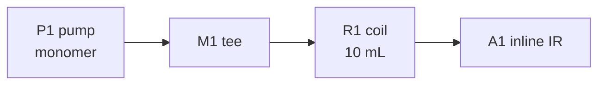

# Apparatus

[[Rig A]]

# Results
Made-up lab note written by the Rig snippet before rig snapshots (Mermaid diagram at the cursor). Kept byte-equal: Lab Kit never back-fills a snapshot.

# Flow platform setup
Rig: [[Rig A]]
Tubing: PFA 0.75 mm

## Pumps
| ID | Model | Carries | Feeds |
|---|---|---|---|
| P1 | make, model | monomer | M1 |
